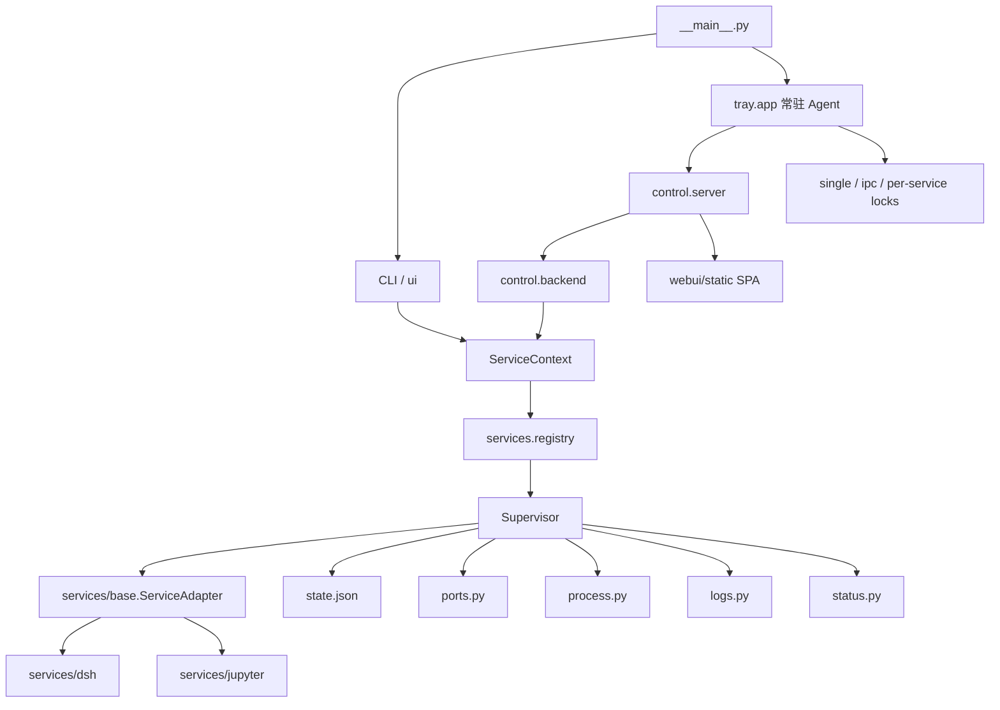

# 架构

## 进程模型

- **常驻 Agent**：托盘图标只是入口；Agent 内运行控制台 HTTP 服务、动作任务、升级任务与服务控制器。
- **CLI**：短命；通过 `Runtime` 读取同一份配置/记忆，直接调用服务层；`ui` 只负责打开控制台。
- **被托管服务**：每个服务是一个独立分离进程（dsh = node，Jupyter = uv tool 的 python），
  关闭终端/控制台窗口不影响；Agent 退出可选择保留或停止。
- **浏览器窗口**：控制台使用独立 `control-browser/` profile；每个服务仍使用自己的 Chromium `--user-data-dir`。



## 分层与模块

| 层 | 模块 | 职责 |
|---|---|---|
| 共享 | `paths.py` | 数据目录、`config.toml` / `memory.toml`、`services/<id>/`、原子写、旧布局迁移 |
| 共享 | `config.py` | `[launcher] [ui] [dsh] [jupyter]` 读取；`config set` 按行编辑保留注释 |
| 共享 | `memory.py` | 启动器写的选择记忆（工作目录、最近目录、内核、按目录内核） |
| 共享 | `ports.py` | 真实 bind 探测、Windows 保留段、候选端口 |
| 共享 | `process.py` | 分离启动、进程树终止、pid + create_time |
| 共享 | `supervisor.py` | 通用生命周期：端口规划 → spawn → 就绪 → 状态 → 停止 |
| 共享 | `state.py` / `logs.py` / `status.py` | 状态文件、日志尾部/轮转、展示快照 |
| 共享 | `discovery.py` / `browser.py` | Chromium 发现、应用窗口、一次性 ticket |
| 服务层 | `services/base.py` | `ServiceSpec` / `LaunchPlan` / `ServiceAdapter` 协议 |
| 服务层 | `services/registry.py` | 服务 id 列表、`all`/逗号解析、按 id 组装 settings + adapter |
| 服务层 | `services/dsh/` | node/bin.js 发现、token URL 解析、接管端口、updates/upgrade |
| 服务层 | `services/jupyter/` | uv tool 发现、HTTP 就绪/关闭、kernelspec 注册、工作目录记忆 |
| UI | `control/` | 控制台 HTTP 服务、一次性入口、Cookie/CSRF、JSON API、任务 |
| UI | `webui/static/` | 无构建 SPA：总览、服务、更新、Jupyter、设置、诊断、关于 |
| UI | `tray/` | 最小托盘入口、单实例/IPC、Agent 生命周期 |
| UI | `install/` | 主控制台入口 + 每服务详情快捷方式（Windows `.lnk` / Linux `.desktop`） |
| 平台 | `platform/` | 分离进程、窗口枚举/置前、打开路径、原生消息框 |

依赖方向：`services/*` → 共享模块；共享模块不导入 `services/*` 的具体服务，
唯一允许出现服务名的地方是 `services/registry.py` 和对应的 `services/<id>/`。

## 服务契约

```python
class ServiceAdapter(Protocol):
    spec: ServiceSpec  # id / 默认端口 / 回退端口 / 是否接管
    settings: Any  # 该服务的配置对象（含 UI 字段）

    def prepare(self, *, host, port) -> LaunchPlan: ...
    def ready(self, plan, state, *, port_open, log_text) -> str | None: ...
    def request_stop(self, state) -> bool: ...  # True = 已发出优雅停止
    def owns_process(self, cmdline, port=None) -> bool: ...
    def start_failure(self, log_text, port) -> str: ...
    def url_from_log(self, log_text) -> str | None: ...
    def work_dir(self) -> Path: ...
    def status_extra(self, state) -> dict[str, str]: ...
    def doctor_rows(self) -> list[tuple[str, str]]: ...
```

两个实现的差异：

| 能力 | dsh | Jupyter |
|---|---|---|
| 服务进程 | `node <bin.js> web --host --port` | `jupyter-lab --no-browser --ServerApp.*` |
| token | 服务自己生成，从日志 `dsh web: <url>` 取 | 启动器生成，经 `JUPYTER_TOKEN` 环境变量传入 |
| 就绪 | 日志出现新标记后的 URL + 端口可连 | `GET <base>api/status` + `Authorization: token` |
| 停止 | 直接杀进程树 | `POST <base>api/shutdown`，超时才杀树 |
| 端口占用 | 是同类 dsh 则接管 | 自动换端口，不接管 |
| 专属命令 | `dsh updates` | `jupyter kernel` / `jupyter workdir` |

## 数据与配置

```
<数据目录>/                 默认 exe 同级 .weblauncher/，可 WEBLAUNCHER_HOME 覆盖
  config.toml               手写/命令写入；注释保留
  memory.toml               启动器原子重写
  launcher.log              动作审计
  upgrades.log              dsh 升级日志
  control-browser/          Web 控制台专用浏览器配置
  tray.lock / tray.json     Agent 单实例锁与 loopback IPC
  services/
    dsh/    state.json  service.log  service.lock  browser/
    jupyter/state.json  service.log  service.lock  browser/
```

优先级：

- 运行参数：CLI > 服务环境变量 > `config.toml` > 默认值
- 工作目录：`--root` > `WEBLAUNCHER_JUPYTER_ROOT` > `[jupyter].root_dir` > `memory.workdir` > `~`
- 内核：`--kernel` > `WEBLAUNCHER_JUPYTER_KERNEL` > 按目录记忆 > 全局记忆 > `[jupyter].kernel` > Jupyter 默认
- 端口：CLI > 环境变量 > `[<service>].port`；省略时上次端口 → 配置端口 → 回退序列，
  并排除其它服务已配置/上次使用的端口

旧品牌数据目录 `.dshlauncher/` 与旧单服务文件（根目录 `state.json` / `dsh-web.log` / `browser/`）在启动时
分别迁移到 `.weblauncher/` 与 `services/dsh/`，配置里的平铺字段继续兼容读取。

## 生命周期

1. 控制台启动：Agent 绑定 loopback HTTP、写入一次性入口信息，打开 `control-browser/`。
2. `Supervisor.effective_port()`：排除其它服务端口 → 探测上次/配置/回退候选。
3. `start()`：可信 state 且进程存活 → 复用；显式换端口 → 先停旧实例。
4. `adapter.prepare()` 生成 argv/env/cwd；核心写 `[launcher] start` 标记后分离启动。
5. 写 `state.json`（pid/create_time/port/url/token/extra）。
6. 轮询 `adapter.ready()`；进程消失或超时则杀树、删 state，并附上适配器的失败解释。
7. `stop()`：state 可信 → 优雅停止 → 等端口释放 → 兜底杀树；state 不可信时只有
   dsh 允许按端口扫描（`stop_untracked`），Jupyter 只报告占用者。

## 并发约定

- 每个服务一把跨进程 `service.lock`，CLI 与 Agent 共用；「启动全部/停止全部」按服务 id 排序依次拿锁，避免死锁。
- 控制台写操作进入 JobManager 后台线程；HTTP 只返回 job id，页面轮询结果；服务动作仍由控制器互斥。
- 控制台入口是一次性 ticket：`/boot/<ticket>` 设置 HttpOnly Cookie 后跳到 SPA；写请求校验 CSRF + Host + Origin。
- `Supervisor` 的读操作不修改实例状态；`ServiceStatus` 是一次性快照。
- 浏览器 dedupe 按各自 `--user-data-dir` 判定，两个服务的窗口互不干扰。

## 新增一个服务

1. 建 `services/<id>/`，实现 `ServiceAdapter`（通常 150–300 行）。
2. 在 `services/registry.py` 的 `SERVICE_IDS` / `build()` / `_definition()` 注册。
3. 在 `config.py` 文档与 `config.toml` 里加 `[<id>]` 默认值。
4. 给控制台增加专属 API 页面/动作时，在 `control/backend.py` 与 `webui/static/app.js` 增加入口。
5. 加适配器测试：argv、就绪、停止、进程归属、状态扩展；共享层已有契约测试。
6. `make smoke SERVICE=<id>` 真机验证 start → status → stop。

不引入 YAML 驱动的“任意进程”配置：就绪、鉴权与优雅停止差异太大，最终会退化成 if/else。

## 验证

```bash
make check                 # ruff + 全量单测
make smoke                 # start all → status all → stop all
make build                 # PyInstaller 打包并部署到 app/
weblauncher doctor         # 每个服务的依赖、端口、状态
weblauncher status all --json
```
