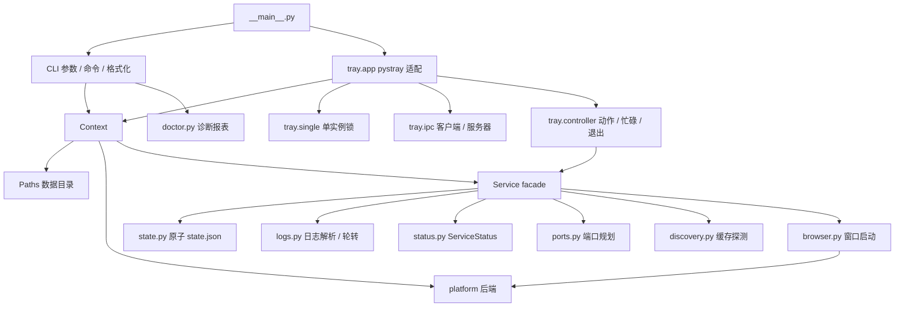

# 架构

## 进程模型

- **启动器进程**：CLI 或托盘二选一；托盘常驻，CLI 命令短命。
- **dsh web 服务**：`Service.start()` 以分离进程启动的 `node .../dsh web`，关闭终端/托盘不影响。
- **浏览器窗口**：独立 `--user-data-dir` 的 Chromium `--app` 窗口，dedupe 时置前。



## 模块职责

| 模块 | 职责 |
|---|---|
| `paths.py` | 数据目录解析、`Paths` 文件布局、原子写、审计日志 |
| `settings.py` | CLI > 环境变量 > `config.toml` > 默认值 |
| `context.py` | `Settings + Paths + 平台后端` 的运行时上下文 |
| `service.py` | 服务生命周期 facade：端口规划、启动/停止/就绪、状态快照 |
| `state.py` / `logs.py` / `status.py` | 状态持久化、日志解析与轮转、展示模型 |
| `ports.py` / `discovery.py` / `browser.py` | 端口判定、依赖发现、Chromium 窗口 |
| `tray/` | `single` 锁、`ipc` 本地请求、`controller` 动作、`app` pystray/菜单 |
| `platform/` | 分离进程、窗口控制、打开路径、原生消息框；`Backend` 协议 + 契约测试 |
| `install/` | Windows `.lnk`、Linux `.desktop`；macOS 明确报不支持自动安装 |
| `__main__.py` / `doctor.py` | CLI 入口与诊断报表 |

## 数据文件

| 文件 | 说明 |
|---|---|
| `state.json` | 服务 pid / create_time / port / url；临时文件 + `os.replace` 原子写 |
| `dsh-web.log` | 服务 stdout；含每次启动的 `[launcher] start` 标记与 token URL |
| `launcher.log` | 启动器动作审计；超过 1 MB 轮转为 `.1`，异常附调用点摘要 |
| `browser/` | 专用 Chromium profile；cookie 绑 `host:port` |
| `tray.lock` | 托盘单实例锁（pid + create_time） |
| `tray.json` | 托盘 loopback IPC 端口与随机 token；正常退出删除 |
| `config.toml` | 可选配置 |

## 启动与退出

1. 双击 / `tray`：`tray.run()` 先读 `tray.json` 投递 `open`；没有托盘时用 `tray.lock` 抢单实例，失败则等 30s 后兜底直接开窗口。
2. 托盘启动：绑定 loopback 端口、写 `tray.json`、显示图标，`setup` 线程执行 `actions.open_dsh()`。
3. `open_dsh` → `Service.ensure()`（复用或启动）→ `browser.launch()`（dedupe 置前或新开）。
4. 退出：`TrayController` 排队等待当前动作，停止 dsh，移除图标；窗口保留。
5. 崩溃/强杀：锁和信息文件在下次启动按 pid/create_time 自动清理；服务保持分离运行。

## 并发约定

- 菜单回调立即返回，重活在 worker 线程；`TrayController` 的忙碌锁保证同一时刻只有一个服务动作。
- 托盘标题每 2s 刷新；菜单重建经 0.15s 合并定时器，减少句柄重建。
- `Service` 读状态不再写实例字段；`ServiceStatus` 是一次性快照。
- `launcher.log` 多进程追加；写入行小且带时间戳。

## 扩展点

- 新 CLI 命令：`HANDLERS` + `build_parser`。
- 新托盘菜单项：`tray/app.py::_menu` + `tray/controller.py` 动作。
- 新平台：实现 `platform/base.py` 的 `Backend` 协议；`test_all_backends_implement_protocol` 会检查漏项。
- 新运行时文件：在 `Paths` 加属性，不要在模块里拼接目录。

## 已知取舍

- `install/discovery/settings` 的配置读取仍使用模块级 `Paths.current()`；正常入口只有一个数据目录。嵌入/测试需要显式传 `Paths`。
- macOS `install` 不自动创建入口（Finder 别名无法携带 `-m dshlauncher` 参数）；直接运行 `tray` 或手动创建别名。
- 菜单状态标签只在托盘动作后刷新；外部 `start/stop` 后点「刷新状态」；「服务状态」弹窗每次实时读取。
- Windows 11 新托盘图标默认进溢出区，需要手动固定一次。

## 验证

```bash
make check                     # ruff + 全量单测
make build                     # PyInstaller 打包并部署到 app/
dshlauncher.exe doctor         # 依赖、托盘后端/进程、端口、服务
dshlauncher.exe status --json  # 脚本可消费的状态
dshlauncher.exe doctor --json  # 诊断 rows
```

隔离冒烟（不影响真实数据）：

```bash
DSHLAUNCHER_HOME=/tmp/dsh-smoke DSHLAUNCHER_PORT=18090 dshlauncher tray
```
